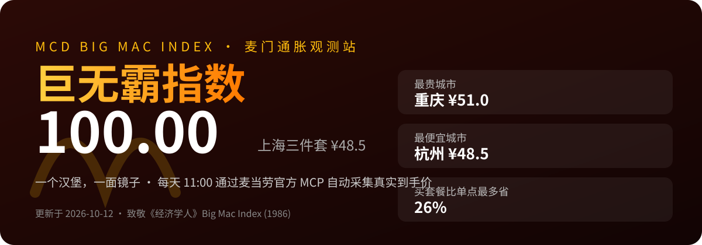
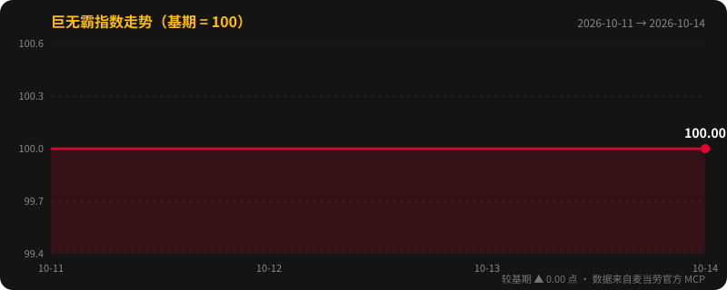
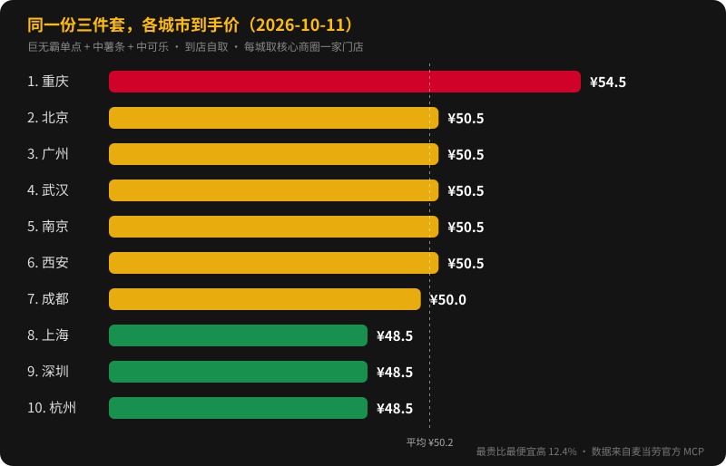
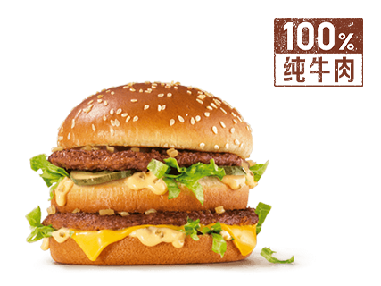
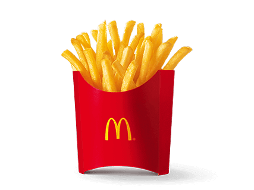

<p align="center"></p>

# 🍔 巨无霸指数 · mcd-bigmac-index

> 一个汉堡，一面镜子。每天自动追踪麦当劳"三件套"的真实到手价，算给你看麦门通胀，也比给你看哪座城市的巨无霸最贵。

[](https://github.com/TTNAN/mcd-bigmac-index/actions/workflows/daily.yml)


<!-- HOOK-START -->
> ### 同一份巨无霸三件套，最贵的店 ¥54.5，最便宜的 ¥48.5，差 12.4%。
>
> 按城市中位数：重庆 ¥51.0，上海、深圳、杭州、南京 ¥48.5，城市间差 5.2%。
>
> 2026-10-13 麦当劳官方 MCP 实测 · 和上次比：南京 降 ¥1.5。
>
> 👉 **[打开在线看板，看看你所在的城市贵不贵](https://ttnan.github.io/mcd-bigmac-index/)** · 🟢 每天 11:00 自动更新 · 觉得有意思就点个 ⭐ Star
<!-- HOOK-END -->

参赛作品：麦当劳程序员创意开发大赛（基于麦当劳官方 MCP Server）。

## 🔎 首日发现（2026-10-11）

很多人以为麦当劳全国一个价。第一天、10 城 30 家门店的真实数据说：**不是。**

- **店和店之间最多差 12.4%**：最贵的是重庆金鹰财富中心餐厅 ¥54.5，最便宜的一批只要 ¥48.5。
- **同一个商圈，隔条街也不一样**：重庆解放碑三家店 ¥51.0–54.5，深圳华强北三家店 ¥48.5–51.0。
- **按城市中位数看，城市间差 5.2%**：上海、深圳、杭州 ¥48.5 最便宜，重庆 ¥51.0 最贵，一线城市不一定更贵。
- **点套餐通常省 25%–26%**：巨无霸三件套多数城市 ¥36.5–37.5；重庆中位数 ¥41.0，只省 20%。

> 每城采同一商圈 3 家营业中门店取中位数，反映的是核心商圈价，不代表全城平均。

<!-- INDEX-START -->
## 📈 今日指数

**100.00**（2026-10-13 更新，较基期 2026-10-11 ▲ 0.00 点）


<!-- INDEX-END -->

<!-- CITIES-START -->
## 🗺️ 城市价格榜（2026-10-13）

同一份「巨无霸 + 中薯条 + 中可乐」，在各城市核心商圈的**到手价**（每城同商圈多家门店取中位数）：



| # | 城市 | 三件套到手价 | 各店价格 | 巨无霸三件套套餐 | 买套餐省 | 采样门店 |
| --- | --- | --- | --- | --- | --- | --- |
| 1 | 重庆 | **¥51.0** | ¥51.0–54.5 | ¥41.0 | 20% | 金鹰财富中心餐厅、1089艺术美丽中心餐厅、解放碑赛博城市餐厅 |
| 2 | 广州 | **¥50.5** | ¥48.5–50.5 | ¥37.5 | 26% | 今日广场餐厅、维多利广场餐厅、正佳五楼餐厅 |
| 3 | 成都 | **¥50.5** | ¥50.0–50.5 | ¥37.5 | 26% | 锦江区联升巷(京都大厦)餐厅、锦江总府路茂业百货餐厅、第一城餐厅 |
| 4 | 武汉 | **¥50.5** | ¥50.0–50.5 | ¥37.5 | 26% | HAPPY站台餐厅(江汉路地铁H出口)、江汉路大汉口餐厅、宝利金餐厅 |
| 5 | 西安 | **¥50.5** | ¥48.5–50.5 | ¥37.5 | 26% | 开元餐厅、北大街餐厅、钟鼓楼餐厅 |
| 6 | 北京 | **¥50.0** | ¥50.0–50.5 | ¥37.0 | 26% | 新东安二号餐厅、王府井东街(澳门中心)餐厅、东四南大街灯市口地铁餐厅 |
| 7 | 上海 | **¥48.5** | ¥48.5 | ¥36.5 | 25% | 黄浦悦荟广场餐厅、黄浦恒基名人购物中心餐厅、黄浦区福州路上海书城餐厅 |
| 8 | 深圳 | **¥48.5** | ¥48.5–51.0 | ¥36.5 | 25% | 华强北茂业餐厅、振中路餐厅、中航城君尚餐厅 |
| 9 | 杭州 | **¥48.5** | ¥48.5 | ¥36.5 | 25% | 上城区延安路东坡宾馆餐厅、上城区工联大厦餐厅、涌金餐厅 |
| 10 | 南京 | **¥48.5** | ¥48.5–50.5 | ¥36.5 | 25% | 新百餐厅、洪武餐厅、青奥城市客厅餐厅 |

> 今天最贵的是 **重庆**（¥51.0），最便宜的是 **上海、深圳、杭州、南京**（¥48.5），相差 5.2%。核心商圈价，不代表全城平均。
<!-- CITIES-END -->

<!-- BASKET-START -->
## 🧺 指数篮子

<p align="center">  </p>

<p align="center">巨无霸 ¥25.5 ＋ 薯条 ¥13.5 ＋ 可乐 ¥9.5 ＝ <b>¥48.5</b>（上海，到手价）</p>

图片与价格均来自麦当劳官方 MCP 实时菜单。
<!-- BASKET-END -->

## 💡 这是什么

1986 年，《经济学人》发明了 Big Mac Index：用同一个巨无霸在各国的价格，衡量货币的真实购买力。

我们把它**本土化、实时化、开源化**：

| | 《经济学人》原版 | 巨无霸指数（本项目） |
| --- | --- | --- |
| 比较对象 | 各国货币 | 中国各城市 + 时间序列 |
| 更新频率 | 一年两次 | **每天** |
| 价格口径 | 菜单标价 | **下单前官方核价的到手价**（`calculate-price`） |
| 数据 | 人工收集 | 麦当劳官方 MCP 接口自动采集，全部开放 |

它回答三个问题：

1. **麦当劳变贵了吗？** 以首次采集日为基期 100，每天看上海核心商圈同一份三件套的到手价涨跌。
2. **哪座城市的巨无霸最贵？** 每天同时采 10 个城市核心商圈门店，做一张城市价格榜。
3. **套餐到底帮你省了多少？** 把"单点三件套"和官方"巨无霸三件套"套餐放在一起比，告诉你点套餐能省几成。

## ⚙️ 怎么做到的

```
每天 11:00（北京时间，午餐时段，巨无霸在售）
        │  GitHub Actions 定时触发
        ▼
┌──────────────── 每个城市跑一遍 ────────────────┐
│ query-nearby-stores  找核心商圈一家营业中的门店 │
│ query-meals          拉实时菜单，匹配篮子单品   │
│ calculate-price      官方核价，得到真实到手价   │
└────────────────────────────────────────────────┘
        ▼
data/prices.jsonl  主序列（上海）    data/cities/日期.json  当日 10 城快照
        ▼
scripts/render.py → 封面图 / 走势图 / 城市榜 SVG + 自动改写本 README
```

- **不是爬虫，不是估算**：所有价格来自麦当劳官方 MCP 的实时接口，到手价由官方 `calculate-price` 计算。
- **零依赖**：只用 Python 标准库，clone 下来就能跑。
- **开放数据**：每天的原始快照都提交在 `data/` 目录，任何人都可以拿去做分析、写作业、画图。
- 编制方法和局限性见 [methodology.md](methodology.md)。

## 🙋 谁会用到

- 好奇"我常吃的那份是不是又涨价了"的麦门信徒
- 想知道换城市生活，快餐成本差多少的打工人
- 需要真实、可复现、按天更新的价格数据做经济学作业的学生
- 想看一个"把梗做成产品"的 MCP 实战案例的开发者

## 🚀 自己跑一份

```bash
# 1. 去 https://open.mcd.cn/mcp 用手机号登录，点"激活"拿到 Token
# 2. 采集 + 出图（Token 只走环境变量，不会写入任何文件）
MCD_MCP_TOKEN=你的token python scripts/snapshot.py
python scripts/render.py
```

换城市或商圈：

```bash
MCD_CITIES="上海市:南京东路,北京市:王府井,长沙市:五一广场" MCD_MCP_TOKEN=你的token python scripts/snapshot.py
```

让它每天自动更新：Fork 本仓库 → Settings → Secrets and variables → Actions → New repository secret，名称 `MCD_MCP_TOKEN`。
想换采样城市，在 Variables 里加 `MCD_CITIES`（格式同上）。

## 📁 目录结构

```
├── scripts/
│   ├── snapshot.py          # 每日采集：门店 → 菜单 → 官方核价，10 城
│   └── render.py            # 指数计算 + 封面/走势/城市榜 SVG + README 自动更新
├── .github/workflows/
│   └── daily.yml            # 每天 11:00（北京时间）自动运行
├── data/
│   ├── prices.jsonl         # 主序列（上海），每天一行
│   ├── cities/YYYY-MM-DD.json  # 每日多城市快照
│   └── cities-latest.json   # 最近一次多城市快照
├── assets/                  # 自动生成的图（banner / index / cities）
├── methodology.md           # 指数编制方法与局限性
├── MCP_INTEGRATION.md       # MCP 接入说明
└── CONTEST_DECLARATION.md
```

## 🔌 用到的 MCP 工具

| 工具 | 用途 |
| --- | --- |
| `query-nearby-stores` | 按城市 + 商圈关键词找营业中的门店 |
| `query-meals` | 拉门店实时菜单，按名称匹配篮子单品和巨无霸套餐 |
| `calculate-price` | 官方核价，返回到手总价（单位：分） |

## 参赛信息

- 活动：麦当劳程序员创意开发大赛
- 报名 Issue：https://github.com/M-China/mcd-developer-innovation-challenge/issues/408
- 许可证：MIT

> 指数仅供娱乐与观察，不构成任何消费或投资建议。
>
> ⭐ **觉得有意思就点个 Star**：数据每天 11:00 自动更新，攒够一个月，就是一份公开的麦当劳城市价格时间序列。
